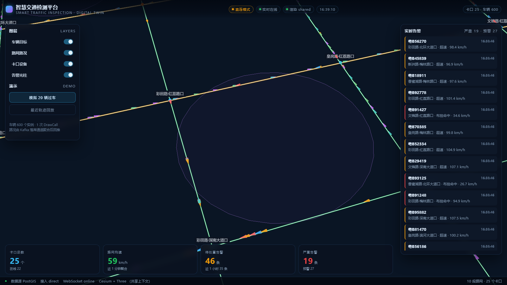

# 智慧交通检测平台

园区/城市片区级交通检测数字孪生底座：**Cesium 空间底座 + Three.js 局部表达 + Vue 业务层 / NestJS 模块化单体 / PostGIS + TDengine 分工**。



> 现场：10 km² 片区、10 段路网、25 个卡口、600 辆实例化车辆、实时布控告警。
> 全部数据为可复现的虚构种子数据（东经 113.95–114.05 / 北纬 22.54–22.62）。

---

## 1. 一分钟跑起来

```bash
# 1) 基础设施（最小可运行：PostGIS + Redis）
docker compose up -d postgis redis

# 2) 依赖 + 建表 + 演示数据
pnpm install
pnpm db:seed

# 3) 起服务（两个终端）
pnpm dev:api     # http://localhost:8080/api/health
pnpm dev:web     # http://localhost:5174
```

打开 <http://localhost:5174>，点左侧「模拟 20 辆过车」即可看到告警、光柱与路况变化。

**登录**（演示账号）：`admin / admin123`（管理，可写）· `viewer / viewer123`（只读）。
REST 全局 Bearer JWT + Socket.IO 握手令牌校验；健康检查与登录接口公开。

前端支持完整的处置闭环：

- **布控规则管理**：左侧面板可新增（超速阈值 / 车牌布控）、启停、删除规则；规则落库 PostGIS（`surveillance_rule` 表，重启不丢），变更经 Redis Pub/Sub 广播刷新所有实例的内存副本；
- **告警确认**：右面板告警可一键确认（`POST /api/surveillance/alarms/:id/ack`），未确认计数以服务端口径为准；
- **告警详情**：点击告警查看编号 / 类型 / 级别 / 速度 / 处置状态，接入 MinIO 后直接展示抓拍原图；
- **告警历史查询**：时间范围 / 类型 / 车牌筛选 + 游标分页（`offset` / `total`），可一键导出 CSV（上限 1000 条）；
- **依赖异常显性化**：任一依赖 `down` 时顶栏出现红色徽章，与 `GET /api/health` 口径一致；
- **园区轴测视图（默认业务视图）**：登录后默认进入，`?render=twin` 或顶栏「切回孪生」
  才回到 Cesium 数字孪生。独立 three.js 上下文 + 正交相机（30° 俯角）+ UnrealBloom 辉光
  + RectAreaLight 面光源。**真实路网是主视觉**：PostGIS 的 LineString 用 Liang–Barsky
  裁到岛内（端点在城市 10km 外，不能按「有点在岛内」过滤），按等级铺 34/26/18m 宽沥青，
  配路缘亮边、中央虚线、路口斑马线；龙门架/信号灯/VMS 沿路与路网交点布设，
  行道树落在街区中心。另有 ETC 检测车道顶棚、地面检测线圈、交通指挥中心、
  路侧边缘机柜、布控区紫色轮廓、按告警所属卡口定位的告警光柱。
  三张浮动指标卡为「在线卡口 / 布控路段 / 未确认告警」，均取自真实业务指标；
  左侧图层开关在默认视图下同样生效（车辆/道路/设备/建筑/告警/布控区）。
  数据同源：路网、建筑、卡口、布控区、告警来自 PostGIS 与业务接口；
  龙门架/信号灯/情报板/机柜等细部是**程序化示意设施**（库里无几何台账）。
  底部「运行态势」卡片独占一条通栏（左侧色标/序号/脉冲点/渐变光带），
  左右面板统一让出 152px 底边并支持内部滚动，任何窗口尺寸下都不与统计卡片重叠。
  全部零外部资产，按材质合并后整岛约 9 次 DrawCall；拖拽平移 / 滚轮缩放，
  顶栏「路口近景」可推近到约 420m 视宽查看车型与设备细节。
  车辆为纯程序化模型：RoundedBox 圆角车身 + 顶点色分区（车漆/深色玻璃/黑轮胎/银轮毂）、
  独立 InstancedMesh 的前白后红灯与贴地接触阴影（2.2x 示意放大保证全景可辨识）。
  **车流由真实路网车道驱动且不穿模**：WS 提供车辆数量/速度/车色，按 `vehicle_id` 稳定抽样 1/8，
  位置按车道双向分道、右侧通行；每条车道是一个「相位队列」——整队按该车道平均真实速度推进
  （低速车 20km/h 兜底），后车位置由「前车位置 −（两车半长之和 + 6m 安全余量）」刚性推导，
  队列顺序固定、相对间距恒定，因此低帧率、队首绕回终点都不会出现后车压过前车。
  **路口信号配时与冲突区互斥**：从真实路网求横竖交点（9 条路 / 40 个路口），
  12s 周期「东西绿 5s → 全红 1s → 南北绿 5s → 全红 1s」，信号灯灯泡随相位变红/绿；
  红灯车队在停止线前排队，互斥按**单个路口**判定（对方占用该路口时等待，
  本方向尾部未清空时继续驶离），初始相位自动避开所有冲突区，启动即无重叠、也不会让某方向饥饿。
  数值验收：`node scripts/screenshot.mjs --spacing`（净距 `violations=0`）、
  `--motion`（坐标持续变化）、`--signals`（模拟 24s / 2 完整周期，`maxConflicts=0`）。
  渲染验收：`node scripts/screenshot.mjs`（`--twin` / `--junction` / `--size=WxH` /
  `--diag` 输出滚动容器诊断 / `--out`），全景见 `docs/planning-view.png`、
  窄屏见 `docs/planning-view-1280.png`、路口近景见 `docs/planning-junction.png`。

冒烟（需 API 已启动）：

```bash
pnpm smoke       # HTTP + 业务链路 + WebSocket，共 13 项
```

## 2. 架构

```
                       ┌────────────────────────── 浏览器 ──────────────────────────┐
                       │ Vue 3 + Pinia                                              │
                       │  ├─ 业务状态（ref/reactive）：图层、告警、选中、KPI          │
                       │  └─ 引擎引用（shallowRef + markRaw）                        │
                       │        │ 命令式调用                                         │
                       │  ┌─────▼──────────────┐   ┌──────────────────────────┐     │
                       │  │ Cesium（地球/相机） │◄──┤ SceneCoordinator          │     │
                       │  │  共享 WebGL 上下文  │   │ 每帧同步矩阵 / 关闭 autoClear│   │
                       │  └────────────────────┘   └──────────┬───────────────┘     │
                       │                                      │ Three.js            │
                       │                          车辆 InstancedMesh（1 DrawCall）  │
                       │                          告警光柱 / 轨迹特效                │
                       └──────────────────────────────┬─────────────────────────────┘
                                    HTTP / WebSocket  │
                       ┌──────────────────────────────▼─────────────────────────────┐
                       │ NestJS 模块化单体                                           │
                       │  checkpoint │ trajectory │ device │ spatial │ surveillance │
                       │  realtime(Socket.IO + Redis Adapter) │ gb28181(REST 适配)   │
                       └───┬──────────────┬──────────────┬──────────────┬────────────┘
                           │              │              │              │
                    ┌──────▼─────┐ ┌──────▼─────┐ ┌──────▼─────┐ ┌──────▼──────┐
                    │ PostGIS    │ │ TDengine   │ │ Redis      │ │ MinIO       │
                    │ 路网/卡口/ │ │ 过车原始   │ │ 规则副本/  │ │ 抓拍图/     │
                    │ 布控区/轨迹│ │ 记录(高频) │ │ 缓存/广播  │ │ 附件(直传)  │
                    └────────────┘ └────────────┘ └────────────┘ └─────────────┘
                           ▲              ▲
                           │   批量落库    │
                    ┌──────┴──────────────┴──────┐
                    │ Kafka 双消费者组            │
                    │  realtime-push → 规则→WS    │
                    │  persistence  → 落库→路况    │
                    └──────────────▲─────────────┘
                                   │
                    卡口过车事件（直连模式：HTTP 同步走完两条链路）
```

### 关键取舍（都写在代码注释里）

| 决策 | 原因 | 位置 |
| --- | --- | --- |
| 双引擎共享同一个 WebGL 上下文 | 两套上下文会黑屏/闪烁；叠加画布在移动端触控失灵且 draw call 翻倍 | `apps/web/src/engine/coordinator.ts` |
| 关闭 Three 的 `autoClear*` | 否则会擦掉 Cesium 已绘制的地球 | 同上 |
| 相机矩阵每帧在 `postRender` 里同步 | 取自不同帧会导致物体抖动/闪烁 | 同上 |
| ECEF 先减原点再进 float32 | 6.4e6 量级直接上传会丢厘米级精度 | 同上 |
| 引擎实例 `shallowRef` + `markRaw` | Vue 深度代理会干扰 Cesium 内部机制，性能塌陷 | `apps/web/src/stores/scene.ts` |
| 车辆用 `InstancedMesh` | 600 目标 1 次 DrawCall；Entity 逐条会压垮帧率 | `apps/web/src/engine/vehicles.ts` |
| 空间谓词写原生 SQL | 不在 ORM 层把几何拉到应用层遍历 | `apps/api/src/modules/spatial` |
| 原始轨迹点只进 TDengine | PostGIS 只存抽稀线段，避免空间表膨胀 | `apps/api/src/modules/trajectory` |
| 布控规则加载到内存副本 | 每秒数万条过车不可能每条查库 | `apps/api/src/modules/surveillance` |
| Socket.IO 必须挂 Redis Adapter | 多实例下跨实例房间消息会丢 | `apps/api/src/infra/redis-io.adapter.ts` |
| SIP 信令不在 NestJS 内实现 | 只做开源国标网关的 REST 适配，媒体流不经过 API | `apps/api/src/modules/gb28181` |

## 2.1 视觉层的三个取舍

夜视风格的交通图，观感主要来自三件事，都写在代码注释里：

| 做法 | 为什么 | 位置 |
| --- | --- | --- |
| 车辆做成**贴地光条**而不是锥体/图标 | 锥体像撒了一地路障；沿航向拉长的光条才读得出「车流在动」，长度随速度变化 | `engine/vehicles.ts` |
| 光条**头亮尾暗 + 车道偏移** | 纯色等宽条会糊成一根粗线：顶点色渐变给出方向，按 id 散到 3 条车道才分得出个体 | `engine/vehicles.ts` |
| 光条尺寸按**相机高度归一** | 世界尺寸固定的条子：5km 看是细线，1km 就成巨型胶囊；按视距收长度，宽度不动 | `engine/vehicles.ts` |
| 路网「暗色路基 + 发光路面」双层 | 只画一条发光细线时，路是浮在黑色背景上的，有路基才有实体感 | `engine/layers.ts` |
| 城市背景体块（**示意数据**） | 只有路网的画面像「黑底上的几根线」；体块提供空间参照，顶部随高度提亮以读体量 | `engine/layers.ts` / `seed.ts` |

**没开的两个**（都试过，写在这里避免重复踩）：

- **Bloom 后处理**：观感确实更「赛博」，但多趟全屏 pass 在集显/软件渲染下帧率断崖，实测无头截图直接超时 → 关闭，靠材质自身的加性/发光效果替代；
- **车辆加性混合**：全景视角下几百条长光条铺满屏幕，过绘制把渲染拖死 → 改回普通混合。

### 文字清晰度

Cesium 默认 `useBrowserRecommendedResolution = true`，在 HiDPI 屏上按 CSS 像素渲染 —— 标签是「画进纹理再拉伸」，1x 渲染被系统放大就是锯齿。这里关掉它并按 `devicePixelRatio` 提分辨率（上限 2），再给标签加**深色描边 + FILL_AND_OUTLINE**，文字边缘才咬得住。

调试深链：`?cam=lng,lat,range[,heading[,pitch]]`，例 `/?cam=114.0,22.575,3200,18,-42`。

## 3. 降级策略（少一个中间件也能跑）

| 依赖 | 缺失时行为 | 如何开启 |
| --- | --- | --- |
| PostGIS | **不可降级**（空间是核心），接口返回 503 并提示 | `docker compose up -d postgis` + `pnpm db:seed` |
| Redis | 缓存退化为进程内，跨实例广播关闭 | `docker compose up -d redis` |
| Kafka | 退到**直接模式**：过车事件走 `POST /api/checkpoints/ingest`，两条链路同步执行 | `--profile stream` + `KAFKA_BROKERS=localhost:9092` |
| TDengine | 过车记录退化为进程内环形缓冲（最近 500 条） | `--profile tds` + `TDENGINE_URL=http://localhost:6041` |
| MinIO | 抓拍图返回占位，接口不报错 | `--profile obj` + `MINIO_ENDPOINT=localhost` |
| GB28181 网关 | `/api/gb28181/*` 返回「未接入」而不是假装成功 | `GB28181_GATEWAY=http://...` |

降级状态会如实出现在 `GET /api/health`（`deps.kafka = up/down/disabled`）与前端顶栏的接入标签上。

## 4. 已验证 / 未验证（如实说明）

本机 Docker Hub 不可达，只拉到 PostGIS 与 Redis 镜像，因此：

| 能力 | 状态 |
| --- | --- |
| 双引擎共享上下文渲染、相机同步、实例化车辆 | ✅ 无头 Chrome 实拍验证（600 实例 / 1 DrawCall） |
| PostGIS 空间查询（`ST_Within` / `ST_DWithin`） | ✅ 冒烟通过 |
| 过车 → 规则匹配 → 告警落库 → WS 推送 | ✅ 冒烟通过（直接模式跑完双链路） |
| 城市背景体块 / 车流光条 / 路况着色 | ✅ 实拍验证（64 体块、700 车流、25 卡口） |
| WebSocket（含 Redis Adapter 挂载） | ✅ 冒烟通过，日志确认 Adapter 已挂载 |
| Kafka 双消费者组 | ⚠️ 代码就绪，**未在本机验证**（镜像拉取失败）；开启方式见 `--profile stream` |
| TDengine 写入/查询 | ⚠️ 代码就绪（REST 建模），未本机验证；当前走环形缓冲 |
| MinIO 预签名直传直下 | ⚠️ 代码就绪，未本机验证 |
| GB28181 REST 适配 | ⚠️ 依赖外部网关，仅实现契约与降级 |

> 这三项属于「外部服务不可用」而非代码未实现：它们都有明确的开启方式与降级日志，
> 在能连通镜像仓库/内网网关的环境中按 README 配置即可生效。

## 5. 目录

```
smart-traffic/
├── apps/
│   ├── api/                      NestJS 模块化单体
│   │   ├── src/infra/            pg / redis / tdengine / kafka / minio / redis-io.adapter
│   │   ├── src/modules/          checkpoint · trajectory · device · spatial ·
│   │   │                         surveillance · realtime · gb28181 · health
│   │   ├── src/db/schema.sql     空间表结构（GIST 索引）
│   │   └── src/seed.ts           建表 + 演示数据（幂等）
│   └── web/                      Vue 3 + Pinia + Cesium + Three
│       ├── src/engine/           coordinator(共享上下文) · vehicles(实例化) · layers · beacons
│       ├── src/stores/           scene(引擎引用) · traffic(业务状态)
│       └── src/api/              http · ws
├── packages/shared-types/        前后端共享契约（WebSocket 事件形状）
├── scripts/smoke.mjs             端到端冒烟（13 项）
├── infra/postgis/                初始化脚本
└── docker-compose.yml            分层 profile：stream / tds / obj
```

## 6. 后续（按触发信号演进，而不是按技术热度）

- **拆分触发**：轨迹消费 CPU 持续成为瓶颈 / 信令需要独立扩缩容 / 规则匹配复杂度上升（见 `docs/01`）。
- **拆分方式**：把今天的进程内调用换成 Kafka Topic，模块间的 Service 接口即为服务契约。
- 前端 OpenLayers 仅在「宏观路网浏览 / 表单化空间查询」场景引入，不做第二个全功能地图。

文档：

- [`docs/01-架构落地对照.md`](docs/01-架构落地对照.md) —— 方案条目 → 代码位置、关键技术细节、本次踩坑
- [`docs/02-运行与验收.md`](docs/02-运行与验收.md) —— 环境变量、分层启动、验收清单、排障
